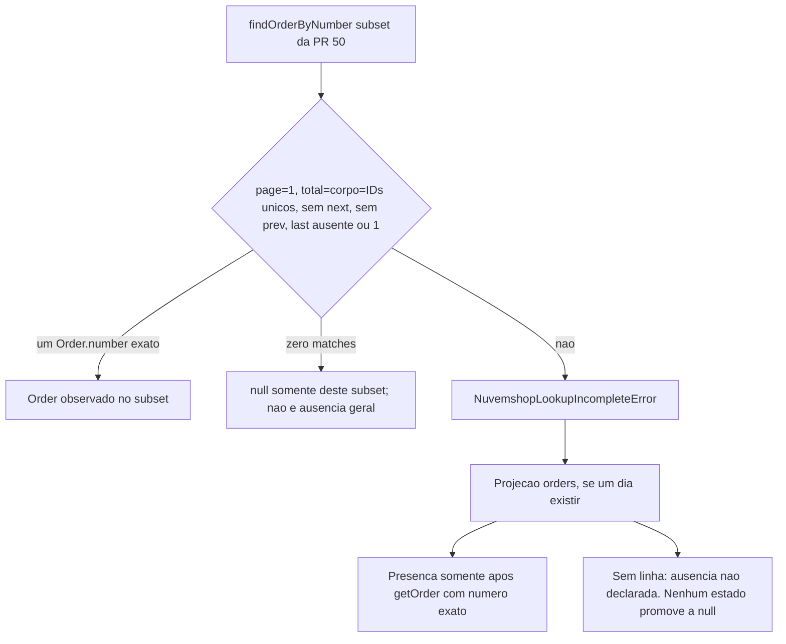

# ADR-003: Cobertura integral da busca exata de pedido por número

## Status

**HUMAN RATIFIED — LIMITATION_AND_PRESENCE_ONLY_DIRECTION (2026-10-20).** A versão inicialmente publicada nesta PR tinha estado `Proposto / PENDING HUMAN ADJUDICATION`. Esta ratificação posterior aceita somente o diagnóstico da limitação e a direção arquitetural *presence-only*; os gates de implementação, DAG e release permanecem separados.

Esta decisão não altera a SPEC, o PLAN nem o TODO, e não conclui a NUV-12. A busca parcial já mergeada na PR #50 permanece o comportamento vigente do adapter. Nenhuma migration, índice, worker, webhook, consumer, merge ou deploy é autorizado pela ratificação.

## Date

2026-10-20

## Contexto

A NUV-12 exige localizar um pedido pelo número comercial canônico, rejeitar falsos positivos de `q`, distinguir ausência comprovada de cobertura incompleta e só devolver `Order` ou `null` quando a cobertura estiver provada, inclusive se a coleção mudar entre requests.

A PR #49 registrou a opção 2, cobertura restrita a uma resposta suficiente. A PR #50 implementou esse subset e foi mergeada em `243cf7786a76759cfdedfbeeb0fbebb1adb6a776`. O estado implantado é `NUV-12-PARTIAL`. `T03-GENERAL` continua `PENDING_COVERAGE_EVIDENCE`.

O contrato geral em [SPEC §10 Orders](../specs/SPEC-nuvemshop.md) continua exigindo exame de todas as páginas filtradas antes de `null`. Se o volume real não permitir essa busca dentro do orçamento, o consumer `orders` mantém uma projeção durável indexada por número antes de `/rastreio`. O adapter não varre implicitamente todos os pedidos.

A retomada integral de 2026-10-20 procurou uma garantia oficial que eliminasse o contraexemplo abaixo. Não a encontrou. A única rota restante nomeada pela SPEC exige índice durável, backend persistente e confirmação de ownership. Por isso a implementação integral para aqui.

### Contraexemplo que permanece válido

Construção lógica, não tráfego observado da loja. `q` é o número de T. `per_page=2`.

1. Estado inicial `[A, B, T, C]`. Página 1 devolve `[A, B]`, `x-total-count=4`, `next=2`, `last=2`.
2. Entre requests, A deixa de corresponder ao texto de nome/e-mail e D passa a corresponder. Novo estado `[B, T, C, D]`, contagem ainda 4.
3. Página 2 devolve `[C, D]`, `prev=1`, `last=2`, sem `next`.

Foram observados quatro IDs distintos, contagem constante e Links consecutivos. T permaneceu na coleção e nunca foi lido. Devolver `null` é ausência falsa. Contagem estável, IDs distintos, Links coerentes, ausência de `next`, repetir a busca até duas respostas iguais, varrer até 10.000, janela de data ou `since_id` sem garantia de membership não eliminam esse caso.

### O que a API 2025-03 comprova

Fontes lidas em 2026-10-20:

- [Order API 2025-03](https://nuvemshop.dev/en-US/api/resources/2025-03/order)
- [Paginação](https://tiendanube.github.io/api-documentation/intro#pagination), página atualizada em 8 de outubro de 2026
- [ERP — Order Management Overview](https://nuvemshop.dev/en-US/apps/erp-guide/orders/overview)

Fatos citados:

- `id` é “the unique numeric identifier” e “different from `number`”.
- `number` é identificador “unique”, “sequential” e “starts at 100”. O guia de ERP diz que o NUMBER “is not accepted as an identifier for integrations” e que, “despite being fixed, is not supported for this purpose”.
- `q`: “Search Orders by the given number; or containing the given text in the customer name or email”.
- `since_id`: “Restrict results to after the specified ID”.
- `created_at_min`: “Show Orders created after date”.
- “Query results are limited to 10.000 items. If your query exceeds this limit, the request will return the corresponding error.”
- Paginação: `page` base 1, `per_page` até 200, `x-total-count`, `Link` com `next`, `prev`, `first` e `last`. “You should use the `Link` URLs instead of building your own.”

Não há, nessas páginas, `GET` pelo número comercial, parâmetro cujo domínio exclua nome/e-mail, ordenação documentada, cursor, snapshot entre páginas ou semântica de leitura sob mutação concorrente. Não foi localizada resposta oficial de suporte com essa garantia. Webhooks notificam o `id`, admitem duplicata e reordenação, e não provam ausência.

## Direção arquitetural ratificada — sem autorização de implementação

O responsável humano ratificou o diagnóstico de limitação e a direção *presence-only*. Os itens abaixo estabelecem limites dessa direção; não aprovam um mecanismo técnico específico, esquema persistente ou alteração normativa do DAG:

1. A rota direta pela API não implementa a NUV-12 integral. `findOrderByNumber` permanece o subset fail-closed da PR #50: um GET lógico com `page=1`, `per_page=200` e `q` canônico. `Order` ou `null` saem só quando `page=1`, `totalCount = items.length = IDs únicos`, `items.length <= perPage`, `nextPage` ausente, `previousPage` ausente e `last` ausente ou `1`, depois da comparação exata de `Order.number`. Qualquer outra observação lança `NuvemshopLookupIncompleteError`. Esse `null` é política do subset para uma resposta, não ausência geral e não garantia do provedor.
2. Uma projeção durável, se for construída no futuro, é owned pelo domínio `orders`, não pelo adapter. Ela pode registrar presença somente depois de `getOrder` cujo `Order.number` canônico seja a chave. `q` não é chave.
3. Ausência comprovada permanece `BLOCKED_COVERAGE_EVIDENCE`. Não há estado alcançável, inclusive `ready_for_absence`, que autorize `null`. Backfill paginado, webhook, contagem, Links coerentes e silêncio de eventos não promovem a chave a pedido inexistente. Promover ausência exige texto oficial novo: consulta exata cujo vazio ou 404 signifique ausência e não case nome/e-mail, ou snapshot/cursor com membership congelada.
4. `T03-GENERAL` não recebe PASS por esta proposta. NUV-22, NUV-23, NUV-24 e NUV-25 não são desbloqueadas. O DAG não é reescrito aqui.
5. HR-07 continua sendo a decisão do ledger genérico de webhooks. Ela não escolhe o schema de pedidos nem autoriza colapsar o índice de número nesse ledger.

Uma garantia oficial nova pode reabrir a rota direta em adjudicação posterior. A ratificação atual não implementa nenhuma alternativa e pode ser revista por nova decisão expressa e rastreável.

## Alternativas

### Rota A — lookup integral na API existente

Rejeitada como implementação desta retomada. Falta a citação que provaria match exato, ausência exata, exclusão de ambiguidade, cobertura multi-page sob mutação, terminação finita e consumo limitado ao mesmo tempo. Unicidade documentada de `number` limita cardinalidade; não congela a membership de `q` entre páginas.

Reabrir somente com texto oficial verificável de uma destas formas: consulta exata por número cujo vazio ou 404 signifique ausência e não case nome/e-mail; ou snapshot/cursor com membership congelada para `GET /orders?q=`.

### Rota B — projeção durável em `orders`

A SPEC nomeia essa projeção quando a busca filtrada não prova cobertura. Ela não existe: `public.Tables` é `never`, `supabase/migrations/` contém só `README.md`, e não há módulo `orders`, webhook, verifier HMAC nem worker. Mesmo depois de existir, a projeção não fecha a NUV-12 integral. Presença observada por `getOrder` pode ser guardada. Ausência continua inalcançável com backfill ou webhook, pelo mesmo contraexemplo e pela falta de primitiva oficial. Adotar a rota B sem esse limite declararia completude falsa.

### Heurística de varredura

Rejeitada. Percorrer páginas, repetir scans ou tratar contagem constante como prova devolveria `null` no contraexemplo.

## Diagrama lógico

O adapter não muda. O `null` do primeiro ramo é só o subset da PR #50. O índice futuro não tem ramo de ausência.

Estados operacionais possíveis no futuro, nenhum implementado: `not_started`, `backfilling`, `webhook_lag`, `gap_detected`. Todos eles, e também a ausência de linha, significam incompletude. `ready_for_absence` não é estado alcançável e não autoriza `null`.

## Ownership

| Peça                                                  | Owner na direção ratificada | Não é owner            |
| ----------------------------------------------------- | ------------------------- | ---------------------- |
| `findOrderByNumber` parcial                           | Adapter Nuvemshop         | Consumer               |
| Índice por número, cobertura, reconciliação, retenção | `orders`                  | Adapter; ledger NUV-16 |
| Ledger de recibo, claim e lease                       | NUV-16/17 depois de HR-07 | Índice de número       |
| Posse, OTP e vínculo de e-mail                        | `identity`, mais tarde    | Número comercial       |
| Disclosure de endereço, itens, NF-e e pagamento       | `orders` / `identity`     | Adapter e `/rastreio`  |

A chave proposta é texto decimal canônico, a mesma política de `readOrderNumber`, única em `(store_id, number)` e em `(store_id, order_id)`. Não usar `number` de JavaScript. Dois IDs com o mesmo número, ou número que muda de ID sem sucessor registrado, entram em quarentena. A loja atual é single-store; a chave composta evita colisão silenciosa se surgir outra loja.

## Contrato de cobertura proposto

Ainda não normativo.

- Presença: linha materializada a partir de `getOrder`, ou de evento seguido de `getOrder`, com `Order.number` canônico igual à chave. `q` não é chave. A linha prova que aquele pedido foi visto, não que a coleção foi varrida.
- Ausência: não há critério. Falta de linha, fim de backfill, fila de webhook vazia, contagem estável ou `ready_for_absence` não autorizam `null` nem “pedido inexistente”.
- Incompletude: é o resultado para toda chave sem linha de presença, inclusive backfill encerrado, webhook em dia, suspensão 402, silêncio após as retentativas e teto de 10.000.
- Backfill paginado não promove cobertura. O mesmo contraexemplo se aplica à carga inicial.
- Webhook não é exatamente uma vez, não tem identificador de entrega e não cobre sozinho pedidos fora dos tópicos selecionados. Os tópicos hoje previstos no PRD são `order/paid`, `order/fulfilled` e `order/cancelled`. `order/created` e `order/updated` exigiriam HR-02 e emenda própria; sem eles, pedidos em aberto ficam fora do índice.
- Reconciliação aplica o snapshot atual de `getOrder`, não a ordem dos eventos. Buraco na sequência de `number` não prova ausência.
- Cancelamento é mudança de estado, não apagamento automático da chave de lookup.

## Dependências

| Dependência                       | Efeito                                                                                                                                                                                                                |
| --------------------------------- | --------------------------------------------------------------------------------------------------------------------------------------------------------------------------------------------------------------------- |
| NUV-HR-02                         | Continua OPEN. Bloqueia API real, escopos e tópicos extras.                                                                                                                                                           |
| NUV-HR-07 / `NUV-OPEN-DURABILITY` | Continua OPEN. Bloqueia NUV-16 a NUV-19. Não desenha a tabela de pedidos.                                                                                                                                             |
| NUV-15 a NUV-19                   | Ledger e despacho genéricos. Não são o índice.                                                                                                                                                                        |
| NUV-11-LEGACY-B                   | Permanece `DEFERRED_PROVIDER_EVIDENCE_REQUIRED`.                                                                                                                                                                      |
| NUV-13                            | Índice por e-mail é contrato separado. Este número não o certifica.                                                                                                                                                   |
| NUV-22 a NUV-25                   | Continuam bloqueadas pela NUV-12 integral. Há um ciclo se “12 completa” passar a significar o consumer `orders`, porque `orders` está depois de NUV-24. A emenda do DAG é decisão humana separada e não é feita aqui. |
| CI-FONT-01                        | Issue #47 permanece aberta.                                                                                                                                                                                           |

## Plano de implementação

Não executar nesta branch.

1. Ratificação limitada do ADR registrada. Elaborar e submeter à aprovação humana separada a emenda de SPEC/PLAN/TODO e do significado de `12` no DAG, sem marcar `T03-GENERAL` como PASS.
2. HR-07 escolhe o backend do ledger. Em paralelo, `orders` especifica schema, RLS, retenção e o sinal de cobertura.
3. NUV-15 a NUV-19 implementam recebimento durável, sem virar o índice.
4. Se `orders` for autorizado a guardar presença, a ingestão começa e permanece incapaz de declarar ausência. Nenhum gate interno de backfill ou webhook muda isso.
5. Leitura de ausência só volta a ser discutida com a primitiva oficial descrita na decisão proposta, em registro novo.
6. Consumers, `/rastreio`, OTP e disclosure continuam em tasks próprias.

## Matriz de testes futura

**NOT RUN.** Não há implementação nova para falhar ou passar. A matriz abaixo é o contrato de prova de uma implementação futura do índice, não desta PR.

| Caso    | Prova exigida depois da adjudicação                                                                                     |
| ------- | ----------------------------------------------------------------------------------------------------------------------- |
| F01     | Match exato só depois de linha reconciliada; página posterior da API sem snapshot continua LookupIncomplete no adapter  |
| F02     | Chave sem linha, backfill encerrado ou webhook em dia continuam incompletude; nenhum estado devolve `null`              |
| F03–F04 | Mutação de membership e o contraexemplo `[A,B,T,C] → [B,T,C,D]` não produzem `null` no adapter nem no índice incompleto |
| F05     | Dois IDs com o mesmo número entram em quarentena                                                                        |
| F06–F08 | IDs duplicados, contagem constante e Links coerentes não certificam cobertura                                           |
| F09–F11 | Página vazia, `last>1` sem `next` e teto de 10.000 permanecem incompletude                                              |
| F12–F14 | Budget, abort e Link hostil preservam a taxonomia atual                                                                 |
| F15     | Número acima de `MAX_SAFE_INTEGER` permanece string canônica                                                            |
| F16–F17 | Erros discrimináveis; `q`, PII, token e payload ausentes dos logs                                                       |
| F18     | Os 56 testes da NUV-12 parcial continuam verdes sem alteração de comportamento                                          |

Fixtures imutáveis de duas páginas não provam a garantia em runtime.

## Migrações necessárias

Nenhuma neste cambio. Se um humano autorizar depois só a presença, a migration de `orders` precisaria de identidade da loja, número canônico em texto, ID do pedido em texto e quarentena, com RLS, sem coluna que promova ausência. O nome do arquivo seguiria a convenção já descrita no README de migrations. Ela não é criada aqui.

## Riscos e rollback

| Risco                                                              | Controle                                                                                      |
| ------------------------------------------------------------------ | --------------------------------------------------------------------------------------------- |
| Ausência falsa se alguém promover backfill ou webhook a cobertura  | Nenhum estado de ausência é alcançável; falta de linha continua incompletude                  |
| Ciclo `12 → orders → 24 → 12`                                      | DAG não é alterado até decisão humana                                                         |
| Índice no adapter ou no ledger HR-07                               | Ownership ratificado como direção em `orders`, sem autorização de implementação                 |
| Pedidos não pagos invisíveis se só `order/paid` alimentar o índice | Tópicos extras bloqueados por HR-02; cobertura não fica pronta                                |
| PII no índice e em logs                                            | Projeção mínima; número não vira tag de Sentry; sem raw body por default                      |
| Rollback                                                           | A ratificação não altera runtime; revisão futura não exige rollback da PR #50                 |

## Gates humanos

1. **CONCLUÍDO neste escopo:** ratificação de direção presence-only, com owner `orders`, sem ramo de ausência. Schema, retenção, privacidade e implementação ainda exigem gates próprios.
2. Decidir o que `12` significa para NUV-22/23/24 sem fingir que T03 passou.
3. Fechar HR-07 antes de qualquer recibo durável.
4. Fechar HR-02 antes de API real ou tópico novo.
5. Aprovar schema, retenção e privacidade da projeção.
6. Só então autorizar implementação, ainda sem merge cego para produção.

## Consequências

- A NUV-12 integral permanece `ARCHITECTURAL_ADJUDICATION_REQUIRED` quanto a ownership e DAG. A ausência comprovada permanece `BLOCKED_COVERAGE_EVIDENCE`.
- O subset da PR #50 continua o comportamento vigente, fail-closed fora da sua resposta única. Esse `null` não é reaceite da cobertura geral.
- Não há candidato técnico de lookup multi-page para revisar ou deployar.
- Uma garantia oficial futura pode superseder este ADR com outro registro; não se reescreve o histórico da PR #49 nem da PR #50.

## Registro posterior — decisão humana de ratificação (2026-10-20)

**Fonte da decisão:** instrução expressa do responsável humano pelo projeto na conversa Product Manager, após a publicação da PR #51 e a revisão documental independente do ADR-003. **Estado de mérito:** `HUMAN_RATIFIED / LIMITATION_AND_PRESENCE_ONLY_DIRECTION`.

**Escopo aceito:** a Order API disponível não comprova cobertura multi-page sob mutação; uma futura projeção durável pertence ao domínio `orders` e, caso autorizada e construída, poderá registrar **presença** somente a partir de identidade de pedido e `Order.number` canônico conferidos por `getOrder`.

**Limites obrigatórios:** chave sem linha no índice não prova ausência. Nem backfill, webhook, contagem estável, links ou `ready_for_absence` autorizam `null` como ausência global. O `null` já permitido no subset da PR #50 é uma política restrita de resposta única; não comprova inexistência na loja e não pode ser promovido por consumers a negativa global, negação de vínculo ou decisão de disclosure.

**Fora da ratificação:** implementação de índice, schema, migration, fila, worker, webhook, HR-02/HR-07, alterações em SPEC/PLAN/TODO, reinterpretação do DAG, contrato do consumer `orders`, `/rastreio`, API autenticada real, merge ou deploy. Cada um exige sua própria adjudicação/autorização.

**Estados preservados:** `NUV-12-PARTIAL / DEPLOYED`; `NUV-12-FULL / ARCHITECTURAL_ADJUDICATION_REQUIRED`; `T03-GENERAL / PENDING_COVERAGE_EVIDENCE`; `ABSENCE / BLOCKED_COVERAGE_EVIDENCE`; NUV-22/23/24/25 continuam bloqueadas pelos requisitos integrais vigentes.

O histórico de que o ADR foi inicialmente publicado como proposta permanece verificável na primeira revisão da PR #51; esta seção registra a decisão posterior sem alegar que a proposta já estivesse ratificada na publicação.
