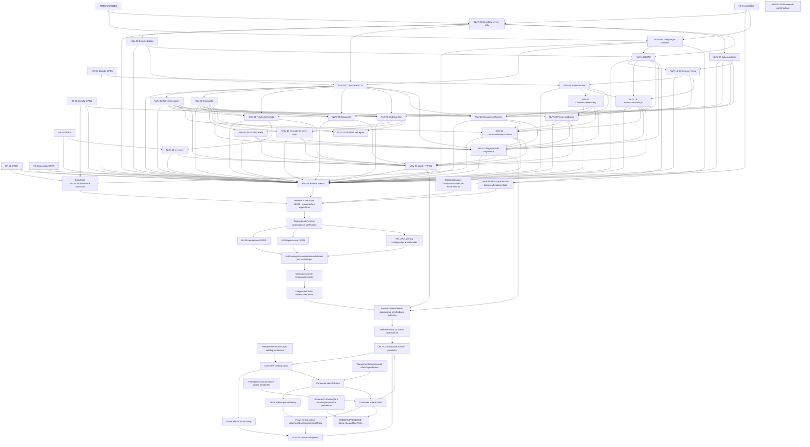

# NUV-DAG-01 — inventário formal dos grafos

**PROPOSED / PENDING HUMAN ADJUDICATION.** Nenhuma aresta proposta está vigente. Baseline congelado: `43a41ca51f0732d1a918e677bdd9e8d2bef29f13` (2026-10-20). A [decisão](../../docs/decisions/ADR-004-nuvemshop-dag-consumer-boundaries.md) e as [emendas exatas](./NUV-DAG-01-amendments.md) são partes da mesma proposta.

## Fontes e regra de expansão

PLAN `plan.md:60–82` é o ponto de partida: todas as arestas NUV-01–25 estão abaixo. Dependências repetidas são deduplicadas; dependências transitivas permanecem deriváveis, nunca removem provas. AUTH + HR-01 aplicam-se globalmente a toda implementação (PLAN:62/80/96; TODO:21–25). `ENTRY24` e a cadeia de rollout expandem a fase interna já documentada em PLAN:76/80/109–111/177, SPEC §19 e TODO:273–276; `N24` representa sua saída. Não são novas tasks/milestones. HR-08 decisão e HR-08 prova real são obrigações do mesmo HR-08 OPEN, não dois HR fechados. HR-03 decide primeiro; ROTATION_RECONCILED exige reconciliação técnica comprovada se coexistência for suportada, ou decisão documentada de inaplicabilidade.

A cadeia futura N24 → catalog → identity → orders deriva de PLAN:177 e Capability Map:19–23/34–46/65–68. Não cria dependência de email/consent: esses módulos são paralelos sob foundation no mapa. OTP exigirá contrato transacional próprio quando planejado. Foundation COMPLETE é upstream de AUTH/adapter (SPEC §3; Capability Map:16–19), sem novo gate. AUTH dos consumers, schema/RLS/retenção, topologia e release são gates futuros definidos, nunca evidência já aceita.

O grafo vigente expandido é acíclico. O ciclo do ADR-003 é **potencial semântico**: existiria se se acrescentasse ORDERS-PRESENCE → N12-FULL, pois N12 → N22/N23 → ENTRY24 → N24 → catalog → identity → orders → presença. Essa aresta não foi aprovada e não entra no grafo vigente nem no proposto. Mesmo com presença entregue, FULL/ausência permanecem sem prova.

## Matriz de tasks — estado do baseline, sem promoção de checklist

Fontes abreviadas: P = [PLAN](./plan.md), T = [TODO](./todo.md), S = [SPEC](../../docs/specs/SPEC-nuvemshop.md). Ancestralidade de merges foi conferida com `git log --first-parent`; merge isoladamente não prova deploy ou aceite de todos os critérios. Os snapshots de 2026-10-09 permanecem históricos.

| Nó     | Dependências atuais diretas                      | Owner              | Tipo               | Estado comprovado                                           | Bloqueadores                                                        | Capacidade entregue / obrigação | Consequência downstream                          | Fonte normativa/evidência                                   |
| ------ | ------------------------------------------------ | ------------------ | ------------------ | ----------------------------------------------------------- | ------------------------------------------------------------------- | ------------------------------- | ------------------------------------------------ | ----------------------------------------------------------- |
| NUV-01 | AUTH, H01                                        | Adapter            | Código/contrato    | COMPLETE / MERGED / DEPLOYED (atestação histórica)          | Uso real HR-02; demais HR aplicáveis                                | Boundary server-only            | N03, N04, N07, N14, ENTRY24                      | P:64–78; T:NUV-01                                           |
| NUV-02 | AUTH, H01                                        | Adapter            | Código/contrato    | COMPLETE / MERGED / DEPLOYED (atestação histórica)          | Uso real HR-02; demais HR aplicáveis                                | Configuração runtime            | N04, N14, ENTRY24, ROTATION_RECONCILED           | P:64–78; T:NUV-02                                           |
| NUV-03 | N01                                              | Adapter            | Código/contrato    | MERGED PR33                                                 | Uso real HR-02; demais HR aplicáveis                                | Erros/redaction                 | N04, N14, ENTRY24                                | P:64–78; T:NUV-03                                           |
| NUV-04 | N01, N02, N03                                    | Adapter            | Código/contrato    | MERGED PR35                                                 | Uso real HR-02; demais HR aplicáveis                                | Transporte HTTP                 | N05, N06, N08, N09, N11, N18, N22, ENTRY24       | P:64–78; T:NUV-04                                           |
| NUV-05 | N04                                              | Adapter            | Código/contrato    | MERGED PR38                                                 | Uso real HR-02; demais HR aplicáveis                                | Retry/rate budget               | N08, N09, N11, N18, N21, N23, ENTRY24            | P:64–78; T:NUV-05                                           |
| NUV-06 | N04                                              | Adapter            | Código/contrato    | MERGED PR39                                                 | Uso real HR-02; demais HR aplicáveis                                | Paginação                       | N08, N09, N11, N12, N13, N22, ENTRY24, P12       | P:64–78; T:NUV-06                                           |
| NUV-07 | N01                                              | Adapter            | Código/contrato    | COMPLETE / MERGED / DEPLOYED (atestação histórica)          | Uso real HR-02; demais HR aplicáveis                                | Schemas/tipos                   | N08, N09, N11, N15, ENTRY24                      | P:64–78; T:NUV-07                                           |
| NUV-08 | N04, N05, N06, N07                               | Adapter            | Código/contrato    | MERGED PR43                                                 | Uso real HR-02; demais HR aplicáveis                                | Products/Variants               | N10, N23, ENTRY24                                | P:64–78; T:NUV-08                                           |
| NUV-09 | N04, N05, N06, N07                               | Adapter            | Código/contrato    | MERGED PR44; R1 ratificada                                  | Uso real HR-02; demais HR aplicáveis                                | Categories                      | N23, ENTRY24                                     | P:64–78; T:NUV-09                                           |
| NUV-10 | H04, N08                                         | Adapter            | Código/contrato    | BLOCKED HR-04; GET multi ilimitado não provado              | HR e autorização operacional próprios; dependências não satisfeitas | Inventory                       | N23, ENTRY24                                     | P:64–78; T:NUV-10                                           |
| NUV-11 | N04, N05, N06, N07                               | Adapter            | Código/contrato    | TECHNICAL_COMPLETE / MERGED / DEPLOYED (registro posterior) | HR e autorização operacional próprios; dependências não satisfeitas | Order get/list                  | N12, N13, ENTRY24, P12                           | P:64–78; T:NUV-11; NUV-11-residual-risks-and-gates.md:52–60 |
| NUV-12 | N06, N11                                         | Adapter            | Código/contrato    | FULL ARCHITECTURAL_ADJUDICATION_REQUIRED; T03 pendente      | HR e autorização operacional próprios; dependências não satisfeitas | Lookup integral                 | N22, N23, ENTRY24                                | P:64–78; T:NUV-12; ADR-003:57–61/201–207                    |
| NUV-13 | N06, N11                                         | Adapter            | Código/contrato    | NOT DELIVERED; elegibilidade local condicionada             | HR e autorização operacional próprios; dependências não satisfeitas | Descoberta por e-mail           | N22, N23, ENTRY24                                | P:64–78; T:NUV-13                                           |
| NUV-14 | N01, N02, N03                                    | Adapter            | Código/contrato    | NOT DELIVERED; fixture local elegível sob gates             | HR e autorização operacional próprios; dependências não satisfeitas | HMAC                            | N15, N19, N20, N22, ENTRY24, ROTATION_RECONCILED | P:64–78; T:NUV-14                                           |
| NUV-15 | N07, N14                                         | Adapter            | Código/contrato    | NOT DELIVERED                                               | HR e autorização operacional próprios; dependências não satisfeitas | Schemas eventos                 | N16, N18, N19, ENTRY24                           | P:64–78; T:NUV-15                                           |
| NUV-16 | H07, N15                                         | Adapter            | Código/contrato    | BLOCKED HR-07                                               | HR e autorização operacional próprios; dependências não satisfeitas | Intake durável                  | N17, N19, N20, ENTRY24                           | P:64–78; T:NUV-16                                           |
| NUV-17 | N16                                              | Adapter            | Código/contrato    | BLOCKED HR-07                                               | HR e autorização operacional próprios; dependências não satisfeitas | Claim/lease/recovery            | N18, N20, N21, N22, ENTRY24                      | P:64–78; T:NUV-17                                           |
| NUV-18 | N04, N05, N15, N17                               | Adapter            | Código/contrato    | BLOCKED HR-07 e dependências                                | HR e autorização operacional próprios; dependências não satisfeitas | Dispatcher/lifecycle            | N21, N22, ENTRY24                                | P:64–78; T:NUV-18                                           |
| NUV-19 | N14, N15, N16                                    | Adapter            | Código/contrato    | BLOCKED HR-07 e dependências                                | HR e autorização operacional próprios; dependências não satisfeitas | Events/manutenção               | N20, N21, N22, N23, ENTRY24                      | P:64–78; T:NUV-19                                           |
| NUV-20 | H08D, N14, N16, N17, N19                         | Adapter            | Código/contrato    | BLOCKED HR-08 decisão e dependências                        | HR e autorização operacional próprios; dependências não satisfeitas | Privacy callbacks               | N21, N22, N23, ENTRY24                           | P:64–78; T:NUV-20                                           |
| NUV-21 | N05, N17, N18, N19, N20                          | Adapter            | Código/contrato    | BLOCKED dependências/HR-07/08                               | HR e autorização operacional próprios; dependências não satisfeitas | Observabilidade/runbook         | N22, N23, ENTRY24, BOOTSTRAP_READY               | P:64–78; T:NUV-21                                           |
| NUV-22 | N04, N06, N12, N13, N14, N17, N18, N19, N20, N21 | Adapter            | Evidência          | BLOCKED FULL e demais dependências                          | HR e autorização operacional próprios; dependências não satisfeitas | Negativos de segurança          | N23, ENTRY24, OPERATIONAL_REVIEW                 | P:64–78; T:NUV-22                                           |
| NUV-23 | N05, N08, N09, N10, N12, N13, N19, N20, N21, N22 | Adapter            | Evidência          | BLOCKED FULL e demais dependências                          | HR e autorização operacional próprios; dependências não satisfeitas | Mock HTTP/CI                    | ENTRY24, OPERATIONAL_REVIEW                      | P:64–78; T:NUV-23                                           |
| NUV-24 | OPERATIONAL_ACCEPTANCE                           | Humano/ops         | Operação/evidência | HUMAN_ONLY / BLOCKED; adapter não operacional               | HR e autorização operacional próprios; dependências não satisfeitas | Marco adapter operacional       | N25, CATALOG, ORDERS                             | P:64–78; T:NUV-24                                           |
| NUV-25 | N24, ORDERS_EVIDENCE, CATALOG_EVIDENCE           | Humano + consumers | Decisão/closure    | HUMAN_ONLY / BLOCKED; integral/consumers pendentes          | HR e autorização operacional próprios; dependências não satisfeitas | Closure integral                | Terminal                                         | P:64–78; T:NUV-25                                           |

## Gates e capacidades discriminados

| Nó                                                                           | Dependências atuais/propostas                                                                                                                                                                                                                                                                                               | Owner/tipo                                           | Estado e capacidade                                                    | Bloqueio/consequência                 | Fonte                                          |
| ---------------------------------------------------------------------------- | --------------------------------------------------------------------------------------------------------------------------------------------------------------------------------------------------------------------------------------------------------------------------------------------------------------------------- | ---------------------------------------------------- | ---------------------------------------------------------------------- | ------------------------------------- | ---------------------------------------------- |
| ABSENCE_EVIDENCE — Prova de ausência sob garantia oficial pendente           | Decisão/prova externa independente                                                                                                                                                                                                                                                                                          | Adapter/consumer conforme label / contrato-evidência | Pendente/futuro; nenhuma conclusão criada                              | GLOBAL_ABSENCE                        | ADR-003:57–61/98–120/195–207; proposta ADR-004 |
| ALL_18 — 18 critérios integrais com evidência efetiva                        | Decisão/prova externa independente; proposta: N24, ORDERS_EVIDENCE, CATALOG_EVIDENCE, T03_GENERAL, GLOBAL_ABSENCE                                                                                                                                                                                                           | Adapter/consumer conforme label / contrato-evidência | Pendente/futuro; nenhuma conclusão criada                              | N25, FINAL_REVIEW                     | P:76–80/104–111/177; S §19–21                  |
| AUTH — AUTH GRANTED                                                          | Decisão/prova externa independente                                                                                                                                                                                                                                                                                          | Adapter/consumer conforme label / contrato-evidência | GRANTED 2026-10-01; não é autorização desta proposta/consumers/release | N01, N02                              | P:76–80/104–111/177; S §19–21                  |
| BOOTSTRAP_READY — Sequência URLs/OAuth/runbook aprovada                      | H02, H08D, N21                                                                                                                                                                                                                                                                                                              | Adapter/consumer conforme label / contrato-evidência | Pendente/futuro; nenhuma conclusão criada                              | RELEASE_HEAD                          | P:76–80/104–111/177; S §19–21                  |
| CATALOG — Consumer catalog futuro                                            | N24, CATALOG_AUTH                                                                                                                                                                                                                                                                                                           | Adapter/consumer conforme label / contrato-evidência | Pendente/futuro; nenhuma conclusão criada                              | IDENTITY, CATALOG_EVIDENCE            | Capability Map:19–23/34–46; P:177              |
| CATALOG_AUTH — Planejamento/autorização catalog pendentes                    | Decisão/prova externa independente                                                                                                                                                                                                                                                                                          | Adapter/consumer conforme label / contrato-evidência | Pendente/futuro; nenhuma conclusão criada                              | CATALOG                               | Capability Map:19–23/34–46; P:177              |
| CATALOG_EVIDENCE — Prova efetiva SLA catalog                                 | CATALOG                                                                                                                                                                                                                                                                                                                     | Adapter/consumer conforme label / contrato-evidência | Pendente/futuro; nenhuma conclusão criada                              | N25, ALL_18                           | P:76–80/104–111/177; S §19–21                  |
| D1 — D1 PENDING HUMAN ADJUDICATION                                           | Decisão/prova externa independente                                                                                                                                                                                                                                                                                          | Humano / decisão ou prova externa                    | Pendente/futuro; nenhuma conclusão criada                              | DAG_EFFECTIVE                         | P:76–80/104–111/177; S §19–21                  |
| D2 — D2 PENDING HUMAN ADJUDICATION                                           | Decisão/prova externa independente                                                                                                                                                                                                                                                                                          | Humano / decisão ou prova externa                    | Pendente/futuro; nenhuma conclusão criada                              | DAG_EFFECTIVE                         | P:76–80/104–111/177; S §19–21                  |
| D3 — D3 PENDING HUMAN ADJUDICATION                                           | Decisão/prova externa independente                                                                                                                                                                                                                                                                                          | Humano / decisão ou prova externa                    | Pendente/futuro; nenhuma conclusão criada                              | DAG_EFFECTIVE                         | P:76–80/104–111/177; S §19–21                  |
| D4 — D4 PENDING HUMAN ADJUDICATION                                           | Decisão/prova externa independente                                                                                                                                                                                                                                                                                          | Humano / decisão ou prova externa                    | Pendente/futuro; nenhuma conclusão criada                              | DAG_EFFECTIVE                         | P:76–80/104–111/177; S §19–21                  |
| D5 — D5 PENDING HUMAN ADJUDICATION                                           | Decisão/prova externa independente                                                                                                                                                                                                                                                                                          | Humano / decisão ou prova externa                    | Pendente/futuro; nenhuma conclusão criada                              | DAG_EFFECTIVE                         | P:76–80/104–111/177; S §19–21                  |
| DAG_EFFECTIVE — D1-D5 + materialização humana pendentes                      | Decisão/prova externa independente; proposta: D1, D2, D3, D4, D5, MATERIALIZATION_REVIEW                                                                                                                                                                                                                                    | Humano / decisão ou prova externa                    | Pendente/futuro; nenhuma conclusão criada                              | N22, N23, ENTRY24                     | P:76–80/104–111/177; S §19–21                  |
| DEPLOY_AUTHORIZED — Deploy/health/version autorizados e verificados          | RELEASE_HEAD                                                                                                                                                                                                                                                                                                                | Humano / decisão ou prova externa                    | Pendente/futuro; nenhuma conclusão criada                              | H06, H08R, PRIVACY_URLS               | P:76–80/104–111/177; S §19–21                  |
| ENTRY24 — NUV-24 entrada interna                                             | N01, N02, N03, N04, N05, N06, N07, N08, N09, N10, N11, N12, N13, N14, N15, N16, N17, N18, N19, N20, N21, N22, N23, H01, H02, H03, H04, H07, H08D; proposta: N01, N02, N03, N04, N05, N06, N07, N08, N09, N10, N11, P12, N13, N14, N15, N16, N17, N18, N19, N20, N21, N22, N23, H01, H02, H03, H04, H07, H08D, DAG_EFFECTIVE | Adapter/consumer conforme label / contrato-evidência | Pendente/futuro; nenhuma conclusão criada                              | RELEASE_HEAD                          | P:76–80/104–111/177; S §19–21                  |
| FINAL_INVENTORY — Integrações finais necessárias ativas                      | TEMP_CLEANUP                                                                                                                                                                                                                                                                                                                | Adapter/consumer conforme label / contrato-evidência | Pendente/futuro; nenhuma conclusão criada                              | OPERATIONAL_REVIEW                    | P:76–80/104–111/177; S §19–21                  |
| FINAL_REVIEW — Revisão adversarial final de closure                          | Decisão/prova externa independente; proposta: ALL_18, N12                                                                                                                                                                                                                                                                   | Adapter/consumer conforme label / contrato-evidência | Pendente/futuro; nenhuma conclusão criada                              | HUMAN_CLOSURE                         | P:76–80/104–111/177; S §19–21                  |
| FULL_CONTRACT — Contrato FULL aprovado e prova executada pendentes           | Decisão/prova externa independente                                                                                                                                                                                                                                                                                          | Adapter/consumer conforme label / contrato-evidência | Pendente/futuro; nenhuma conclusão criada                              | N12, T03_GENERAL                      | ADR-003:57–61/98–120/195–207; proposta ADR-004 |
| GLOBAL_ABSENCE — GLOBAL_ABSENCE BLOCKED_COVERAGE_EVIDENCE                    | Decisão/prova externa independente; proposta: OFFICIAL_COVERAGE, ABSENCE_EVIDENCE                                                                                                                                                                                                                                           | Adapter/consumer conforme label / contrato-evidência | Pendente/futuro; nenhuma conclusão criada                              | N12, N25, ALL_18                      | ADR-003:57–61/98–120/195–207; proposta ADR-004 |
| H01 — HR-01 CLOSED                                                           | Decisão/prova externa independente                                                                                                                                                                                                                                                                                          | Humano / decisão ou prova externa                    | CLOSED 2026-10-01                                                      | N01, N02, ENTRY24                     | P:76–80/104–111/177; S §19–21                  |
| H02 — HR-02 OPEN                                                             | Decisão/prova externa independente                                                                                                                                                                                                                                                                                          | Humano / decisão ou prova externa                    | Pendente/futuro; nenhuma conclusão criada                              | ENTRY24, BOOTSTRAP_READY              | P:76–80/104–111/177; S §19–21                  |
| H03 — HR-03 decisão OPEN                                                     | Decisão/prova externa independente                                                                                                                                                                                                                                                                                          | Humano / decisão ou prova externa                    | Pendente/futuro; nenhuma conclusão criada                              | ENTRY24, ROTATION_RECONCILED          | P:76–80/104–111/177; S §19–21                  |
| H04 — HR-04 OPEN                                                             | Decisão/prova externa independente                                                                                                                                                                                                                                                                                          | Humano / decisão ou prova externa                    | Pendente/futuro; nenhuma conclusão criada                              | N10, ENTRY24                          | P:76–80/104–111/177; S §19–21                  |
| H05 — HR-05 OPEN somente cart/checkout                                       | Decisão/prova externa independente                                                                                                                                                                                                                                                                                          | Humano / decisão ou prova externa                    | Pendente/futuro; nenhuma conclusão criada                              | Terminal; HR-05 somente cart/checkout | P:76–80/104–111/177; S §19–21                  |
| H06 — HR-06 operacional OPEN                                                 | DEPLOY_AUTHORIZED                                                                                                                                                                                                                                                                                                           | Humano / decisão ou prova externa                    | Pendente/futuro; nenhuma conclusão criada                              | SMOKE_RECOVERY                        | P:76–80/104–111/177; S §19–21                  |
| H07 — HR-07 decisão OPEN                                                     | Decisão/prova externa independente                                                                                                                                                                                                                                                                                          | Humano / decisão ou prova externa                    | Pendente/futuro; nenhuma conclusão criada                              | N16, ENTRY24                          | P:76–80/104–111/177; S §19–21                  |
| H08D — HR-08 decisão OPEN                                                    | Decisão/prova externa independente                                                                                                                                                                                                                                                                                          | Humano / decisão ou prova externa                    | Pendente/futuro; nenhuma conclusão criada                              | N20, ENTRY24, BOOTSTRAP_READY         | P:76–80/104–111/177; S §19–21                  |
| H08R — HR-08 prova real OPEN                                                 | DEPLOY_AUTHORIZED                                                                                                                                                                                                                                                                                                           | Humano / decisão ou prova externa                    | Pendente/futuro; nenhuma conclusão criada                              | SMOKE_RECOVERY                        | P:76–80/104–111/177; S §19–21                  |
| HUMAN_CLOSURE — Aprovação humana de closure pendente                         | Decisão/prova externa independente; proposta: FINAL_REVIEW                                                                                                                                                                                                                                                                  | Humano / decisão ou prova externa                    | Pendente/futuro; nenhuma conclusão criada                              | N25                                   | P:76–80/104–111/177; S §19–21                  |
| IDENTITY — Consumer identity futuro                                          | CATALOG, IDENTITY_AUTH                                                                                                                                                                                                                                                                                                      | Adapter/consumer conforme label / contrato-evidência | Pendente/futuro; nenhuma conclusão criada                              | ORDERS, IDENTITY_EVIDENCE             | Capability Map:19–23/34–46; P:177              |
| IDENTITY_AUTH — Planejamento/autorização identity pendentes                  | Decisão/prova externa independente                                                                                                                                                                                                                                                                                          | Adapter/consumer conforme label / contrato-evidência | Pendente/futuro; nenhuma conclusão criada                              | IDENTITY                              | Capability Map:19–23/34–46; P:177              |
| IDENTITY_EVIDENCE — Prova efetiva posse/identity                             | IDENTITY                                                                                                                                                                                                                                                                                                                    | Adapter/consumer conforme label / contrato-evidência | Pendente/futuro; nenhuma conclusão criada                              | ORDERS_EVIDENCE                       | P:76–80/104–111/177; S §19–21                  |
| MATERIALIZATION_REVIEW — PR normativa posterior revisada e merge humano      | Decisão/prova externa independente                                                                                                                                                                                                                                                                                          | Humano / decisão ou prova externa                    | Pendente/futuro; nenhuma conclusão criada                              | DAG_EFFECTIVE                         | P:76–80/104–111/177; S §19–21                  |
| OFFICIAL_COVERAGE — Nova garantia oficial não disponível                     | Decisão/prova externa independente                                                                                                                                                                                                                                                                                          | Humano / decisão ou prova externa                    | Pendente/futuro; nenhuma conclusão criada                              | T03_GENERAL, GLOBAL_ABSENCE           | ADR-003:57–61/98–120/195–207; proposta ADR-004 |
| OPERATIONAL_ACCEPTANCE — Aceite humano do marco operacional                  | OPERATIONAL_REVIEW                                                                                                                                                                                                                                                                                                          | Adapter/consumer conforme label / contrato-evidência | Pendente/futuro; nenhuma conclusão criada                              | N24                                   | P:76–80/104–111/177; S §19–21                  |
| OPERATIONAL_REVIEW — Revisão independente operacional sem findings materiais | FINAL_INVENTORY, N22, N23                                                                                                                                                                                                                                                                                                   | Adapter/consumer conforme label / contrato-evidência | Pendente/futuro; nenhuma conclusão criada                              | OPERATIONAL_ACCEPTANCE                | P:76–80/104–111/177; S §19–21                  |
| ORDERS — Consumer orders futuro                                              | N24, IDENTITY, ORDERS_AUTH                                                                                                                                                                                                                                                                                                  | Adapter/consumer conforme label / contrato-evidência | Pendente/futuro; nenhuma conclusão criada                              | ORDERS_PRESENCE, ORDERS_EVIDENCE      | Capability Map:19–23/34–46; P:177              |
| ORDERS_AUTH — Planejamento/autorização orders pendentes                      | Decisão/prova externa independente                                                                                                                                                                                                                                                                                          | Adapter/consumer conforme label / contrato-evidência | Pendente/futuro; nenhuma conclusão criada                              | ORDERS                                | Capability Map:19–23/34–46; P:177              |
| ORDERS_EVIDENCE — Prova efetiva orders cobertura/disclosure/idempotência     | ORDERS, IDENTITY_EVIDENCE                                                                                                                                                                                                                                                                                                   | Adapter/consumer conforme label / contrato-evidência | Pendente/futuro; nenhuma conclusão criada                              | N25, ALL_18                           | P:76–80/104–111/177; S §19–21                  |
| ORDERS_PRESENCE — ORDERS-PRESENCE futura não certifica FULL                  | ORDERS, PRESENCE_DESIGN                                                                                                                                                                                                                                                                                                     | Adapter/consumer conforme label / contrato-evidência | Pendente/futuro; nenhuma conclusão criada                              | Terminal; HR-05 somente cart/checkout | ADR-003:57–61/98–120/195–207; proposta ADR-004 |
| P12 — NUV-12-PARTIAL entregue                                                | N06, N11                                                                                                                                                                                                                                                                                                                    | Adapter/consumer conforme label / contrato-evidência | COMPLETE / MERGED / DEPLOYED conforme pedido + ADR-003; subset PR50    | N22, N23, ENTRY24                     | ADR-003:57–61/98–120/195–207; proposta ADR-004 |
| PRESENCE_DESIGN — Schema/RLS/retenção e autorização próprios pendentes       | Decisão/prova externa independente                                                                                                                                                                                                                                                                                          | Adapter/consumer conforme label / contrato-evidência | Pendente/futuro; nenhuma conclusão criada                              | ORDERS_PRESENCE                       | ADR-003:57–61/98–120/195–207; proposta ADR-004 |
| PRIVACY_URLS — Três URLs privacy configuradas e verificadas                  | DEPLOY_AUTHORIZED                                                                                                                                                                                                                                                                                                           | Adapter/consumer conforme label / contrato-evidência | Pendente/futuro; nenhuma conclusão criada                              | SMOKE_RECOVERY                        | P:76–80/104–111/177; S §19–21                  |
| RELEASE_HEAD — Release humana por HEAD + autorizações específicas            | ENTRY24, ROTATION_RECONCILED, BOOTSTRAP_READY, TOPOLOGY_PROOF                                                                                                                                                                                                                                                               | Humano / decisão ou prova externa                    | Pendente/futuro; nenhuma conclusão criada                              | DEPLOY_AUTHORIZED                     | P:76–80/104–111/177; S §19–21                  |
| ROTATION_RECONCILED — Decisão HR-03 aplicada ou dispensa fundamentada        | H03, N02, N14                                                                                                                                                                                                                                                                                                               | Adapter/consumer conforme label / contrato-evidência | Pendente/futuro; nenhuma conclusão criada                              | RELEASE_HEAD                          | P:76–80/104–111/177; S §19–21                  |
| SMOKE_RECOVERY — Auth/entrega/recovery/observabilidade por família/topic     | H06, H08R, PRIVACY_URLS                                                                                                                                                                                                                                                                                                     | Adapter/consumer conforme label / contrato-evidência | Pendente/futuro; nenhuma conclusão criada                              | TEMP_CLEANUP                          | P:76–80/104–111/177; S §19–21                  |
| T03_GENERAL — T03-GENERAL PENDING_COVERAGE_EVIDENCE                          | Decisão/prova externa independente; proposta: OFFICIAL_COVERAGE, FULL_CONTRACT                                                                                                                                                                                                                                              | Adapter/consumer conforme label / contrato-evidência | Pendente/futuro; nenhuma conclusão criada                              | N12, N25, ALL_18                      | ADR-003:57–61/98–120/195–207; proposta ADR-004 |
| TEMP_CLEANUP — Cleanup somente temporário próprio                            | SMOKE_RECOVERY                                                                                                                                                                                                                                                                                                              | Adapter/consumer conforme label / contrato-evidência | Pendente/futuro; nenhuma conclusão criada                              | FINAL_INVENTORY                       | P:76–80/104–111/177; S §19–21                  |
| TOPOLOGY_PROOF — Topologia/budget comprovado antes de ativar leituras        | Decisão/prova externa independente                                                                                                                                                                                                                                                                                          | Adapter/consumer conforme label / contrato-evidência | Pendente/futuro; nenhuma conclusão criada                              | RELEASE_HEAD                          | P:76–80/104–111/177; S §19–21                  |

`HR-05` permanece OPEN, owner product/commerce, decisão de handoff cart/checkout; não bloqueia core/NUV-24/25 sem cart. Seu downstream é cart e checkout, fora do recorte deste DAG; não é dispensado. Fonte P:108, S §19. HR-02/03/04/06/07/08 permanecem OPEN; HR-06 e HR-08 real são obrigatórios antes da saída24. Privacy/lifecycle e fiscal não ganham exceção adicional.

## Grafos completos e tabelas de arestas

Os diagramas e tabelas abaixo expandem cada dependência direta (não apenas as arestas alteradas). Labels têm seus significados na matriz; símbolos futuros explicitamente definidos não afirmam capacidade existente. `N12` sempre significa FULL; `P12` sempre o subset.

### Vigente — expansão de gates já documentados



| Destino                | Todas as dependências diretas                                                                                                                    |
| ---------------------- | ------------------------------------------------------------------------------------------------------------------------------------------------ |
| BOOTSTRAP_READY        | H02, H08D, N21                                                                                                                                   |
| CATALOG                | CATALOG_AUTH, N24                                                                                                                                |
| CATALOG_EVIDENCE       | CATALOG                                                                                                                                          |
| DEPLOY_AUTHORIZED      | RELEASE_HEAD                                                                                                                                     |
| ENTRY24                | H01, H02, H03, H04, H07, H08D, N01, N02, N03, N04, N05, N06, N07, N08, N09, N10, N11, N12, N13, N14, N15, N16, N17, N18, N19, N20, N21, N22, N23 |
| FINAL_INVENTORY        | TEMP_CLEANUP                                                                                                                                     |
| H05                    |                                                                                                                                                  |
| H06                    | DEPLOY_AUTHORIZED                                                                                                                                |
| H08R                   | DEPLOY_AUTHORIZED                                                                                                                                |
| IDENTITY               | CATALOG, IDENTITY_AUTH                                                                                                                           |
| IDENTITY_EVIDENCE      | IDENTITY                                                                                                                                         |
| N01                    | AUTH, H01                                                                                                                                        |
| N02                    | AUTH, H01                                                                                                                                        |
| N03                    | N01                                                                                                                                              |
| N04                    | N01, N02, N03                                                                                                                                    |
| N05                    | N04                                                                                                                                              |
| N06                    | N04                                                                                                                                              |
| N07                    | N01                                                                                                                                              |
| N08                    | N04, N05, N06, N07                                                                                                                               |
| N09                    | N04, N05, N06, N07                                                                                                                               |
| N10                    | H04, N08                                                                                                                                         |
| N11                    | N04, N05, N06, N07                                                                                                                               |
| N12                    | N06, N11                                                                                                                                         |
| N13                    | N06, N11                                                                                                                                         |
| N14                    | N01, N02, N03                                                                                                                                    |
| N15                    | N07, N14                                                                                                                                         |
| N16                    | H07, N15                                                                                                                                         |
| N17                    | N16                                                                                                                                              |
| N18                    | N04, N05, N15, N17                                                                                                                               |
| N19                    | N14, N15, N16                                                                                                                                    |
| N20                    | H08D, N14, N16, N17, N19                                                                                                                         |
| N21                    | N05, N17, N18, N19, N20                                                                                                                          |
| N22                    | N04, N06, N12, N13, N14, N17, N18, N19, N20, N21                                                                                                 |
| N23                    | N05, N08, N09, N10, N12, N13, N19, N20, N21, N22                                                                                                 |
| N24                    | OPERATIONAL_ACCEPTANCE                                                                                                                           |
| N25                    | CATALOG_EVIDENCE, N24, ORDERS_EVIDENCE                                                                                                           |
| OPERATIONAL_ACCEPTANCE | OPERATIONAL_REVIEW                                                                                                                               |
| OPERATIONAL_REVIEW     | FINAL_INVENTORY, N22, N23                                                                                                                        |
| ORDERS                 | IDENTITY, N24, ORDERS_AUTH                                                                                                                       |
| ORDERS_EVIDENCE        | IDENTITY_EVIDENCE, ORDERS                                                                                                                        |
| ORDERS_PRESENCE        | ORDERS, PRESENCE_DESIGN                                                                                                                          |
| P12                    | N06, N11                                                                                                                                         |
| PRIVACY_URLS           | DEPLOY_AUTHORIZED                                                                                                                                |
| RELEASE_HEAD           | BOOTSTRAP_READY, ENTRY24, ROTATION_RECONCILED, TOPOLOGY_PROOF                                                                                    |
| ROTATION_RECONCILED    | H03, N02, N14                                                                                                                                    |
| SMOKE_RECOVERY         | H06, H08R, PRIVACY_URLS                                                                                                                          |
| TEMP_CLEANUP           | SMOKE_RECOVERY                                                                                                                                   |

### Proposto — somente após adjudicação/materialização

```mermaid
flowchart TD
  ABSENCE_EVIDENCE["Prova de ausência sob garantia oficial pendente"]
  ALL_18["18 critérios integrais com evidência efetiva"]
  AUTH["AUTH GRANTED"]
  BOOTSTRAP_READY["Sequência URLs/OAuth/runbook aprovada"]
  CATALOG["Consumer catalog futuro"]
  CATALOG_AUTH["Planejamento/autorização catalog pendentes"]
  CATALOG_EVIDENCE["Prova efetiva SLA catalog"]
  D1["D1 PENDING HUMAN ADJUDICATION"]
  D2["D2 PENDING HUMAN ADJUDICATION"]
  D3["D3 PENDING HUMAN ADJUDICATION"]
  D4["D4 PENDING HUMAN ADJUDICATION"]
  D5["D5 PENDING HUMAN ADJUDICATION"]
  DAG_EFFECTIVE["D1-D5 + materialização humana pendentes"]
  DEPLOY_AUTHORIZED["Deploy/health/version autorizados e verificados"]
  ENTRY24["NUV-24 entrada interna"]
  FINAL_INVENTORY["Integrações finais necessárias ativas"]
  FINAL_REVIEW["Revisão adversarial final de closure"]
  FULL_CONTRACT["Contrato FULL aprovado e prova executada pendentes"]
  GLOBAL_ABSENCE["GLOBAL_ABSENCE BLOCKED_COVERAGE_EVIDENCE"]
  H01["HR-01 CLOSED"]
  H02["HR-02 OPEN"]
  H03["HR-03 decisão OPEN"]
  H04["HR-04 OPEN"]
  H05["HR-05 OPEN somente cart/checkout"]
  H06["HR-06 operacional OPEN"]
  H07["HR-07 decisão OPEN"]
  H08D["HR-08 decisão OPEN"]
  H08R["HR-08 prova real OPEN"]
  HUMAN_CLOSURE["Aprovação humana de closure pendente"]
  IDENTITY["Consumer identity futuro"]
  IDENTITY_AUTH["Planejamento/autorização identity pendentes"]
  IDENTITY_EVIDENCE["Prova efetiva posse/identity"]
  MATERIALIZATION_REVIEW["PR normativa posterior revisada e merge humano"]
  N01["NUV-01 Boundary server-only"]
  N02["NUV-02 Configuração runtime"]
  N03["NUV-03 Erros/redaction"]
  N04["NUV-04 Transporte HTTP"]
  N05["NUV-05 Retry/rate budget"]
  N06["NUV-06 Paginação"]
  N07["NUV-07 Schemas/tipos"]
  N08["NUV-08 Products/Variants"]
  N09["NUV-09 Categories"]
  N10["NUV-10 Inventory"]
  N11["NUV-11 Order get/list"]
  N12["NUV-12-FULL bloqueada"]
  N13["NUV-13 Descoberta por e-mail"]
  N14["NUV-14 HMAC"]
  N15["NUV-15 Schemas eventos"]
  N16["NUV-16 Intake durável"]
  N17["NUV-17 Claim/lease/recovery"]
  N18["NUV-18 Dispatcher/lifecycle"]
  N19["NUV-19 Events/manutenção"]
  N20["NUV-20 Privacy callbacks"]
  N21["NUV-21 Observabilidade/runbook"]
  N22["NUV-22 Negativos de segurança"]
  N23["NUV-23 Mock HTTP/CI"]
  N24["NUV-24 saída operacional pendente"]
  N25["NUV-25 closure bloqueada"]
  OFFICIAL_COVERAGE["Nova garantia oficial não disponível"]
  OPERATIONAL_ACCEPTANCE["Aceite humano do marco operacional"]
  OPERATIONAL_REVIEW["Revisão independente operacional sem findings materiais"]
  ORDERS["Consumer orders futuro"]
  ORDERS_AUTH["Planejamento/autorização orders pendentes"]
  ORDERS_EVIDENCE["Prova efetiva orders cobertura/disclosure/idempotência"]
  ORDERS_PRESENCE["ORDERS-PRESENCE futura não certifica FULL"]
  P12["NUV-12-PARTIAL entregue"]
  PRESENCE_DESIGN["Schema/RLS/retenção e autorização próprios pendentes"]
  PRIVACY_URLS["Três URLs privacy configuradas e verificadas"]
  RELEASE_HEAD["Release humana por HEAD + autorizações específicas"]
  ROTATION_RECONCILED["Decisão HR-03 aplicada ou dispensa fundamentada"]
  SMOKE_RECOVERY["Auth/entrega/recovery/observabilidade por família/topic"]
  T03_GENERAL["T03-GENERAL PENDING_COVERAGE_EVIDENCE"]
  TEMP_CLEANUP["Cleanup somente temporário próprio"]
  TOPOLOGY_PROOF["Topologia/budget comprovado antes de ativar leituras"]
  CATALOG_EVIDENCE & GLOBAL_ABSENCE & N24 & ORDERS_EVIDENCE & T03_GENERAL --> ALL_18
  H02 & H08D & N21 --> BOOTSTRAP_READY
  CATALOG_AUTH & N24 --> CATALOG
  CATALOG --> CATALOG_EVIDENCE
  D1 & D2 & D3 & D4 & D5 & MATERIALIZATION_REVIEW --> DAG_EFFECTIVE
  RELEASE_HEAD --> DEPLOY_AUTHORIZED
  DAG_EFFECTIVE & H01 & H02 & H03 & H04 & H07 & H08D & N01 & N02 & N03 & N04 & N05 & N06 & N07 & N08 & N09 & N10 & N11 & N13 & N14 & N15 & N16 & N17 & N18 & N19 & N20 & N21 & N22 & N23 & P12 --> ENTRY24
  TEMP_CLEANUP --> FINAL_INVENTORY
  ALL_18 & N12 --> FINAL_REVIEW
  ABSENCE_EVIDENCE & OFFICIAL_COVERAGE --> GLOBAL_ABSENCE
  DEPLOY_AUTHORIZED --> H06
  DEPLOY_AUTHORIZED --> H08R
  FINAL_REVIEW --> HUMAN_CLOSURE
  CATALOG & IDENTITY_AUTH --> IDENTITY
  IDENTITY --> IDENTITY_EVIDENCE
  AUTH & H01 --> N01
  AUTH & H01 --> N02
  N01 --> N03
  N01 & N02 & N03 --> N04
  N04 --> N05
  N04 --> N06
  N01 --> N07
  N04 & N05 & N06 & N07 --> N08
  N04 & N05 & N06 & N07 --> N09
  H04 & N08 --> N10
  N04 & N05 & N06 & N07 --> N11
  FULL_CONTRACT & GLOBAL_ABSENCE & N06 & N11 & T03_GENERAL --> N12
  N06 & N11 --> N13
  N01 & N02 & N03 --> N14
  N07 & N14 --> N15
  H07 & N15 --> N16
  N16 --> N17
  N04 & N05 & N15 & N17 --> N18
  N14 & N15 & N16 --> N19
  H08D & N14 & N16 & N17 & N19 --> N20
  N05 & N17 & N18 & N19 & N20 --> N21
  DAG_EFFECTIVE & N04 & N06 & N13 & N14 & N17 & N18 & N19 & N20 & N21 & P12 --> N22
  DAG_EFFECTIVE & N05 & N08 & N09 & N10 & N13 & N19 & N20 & N21 & N22 & P12 --> N23
  OPERATIONAL_ACCEPTANCE --> N24
  ALL_18 & CATALOG_EVIDENCE & GLOBAL_ABSENCE & HUMAN_CLOSURE & N12 & N24 & ORDERS_EVIDENCE & T03_GENERAL --> N25
  OPERATIONAL_REVIEW --> OPERATIONAL_ACCEPTANCE
  FINAL_INVENTORY & N22 & N23 --> OPERATIONAL_REVIEW
  IDENTITY & N24 & ORDERS_AUTH --> ORDERS
  IDENTITY_EVIDENCE & ORDERS --> ORDERS_EVIDENCE
  ORDERS & PRESENCE_DESIGN --> ORDERS_PRESENCE
  N06 & N11 --> P12
  DEPLOY_AUTHORIZED --> PRIVACY_URLS
  BOOTSTRAP_READY & ENTRY24 & ROTATION_RECONCILED & TOPOLOGY_PROOF --> RELEASE_HEAD
  H03 & N02 & N14 --> ROTATION_RECONCILED
  H06 & H08R & PRIVACY_URLS --> SMOKE_RECOVERY
  FULL_CONTRACT & OFFICIAL_COVERAGE --> T03_GENERAL
  SMOKE_RECOVERY --> TEMP_CLEANUP
```



| Destino                | Todas as dependências diretas                                                                                                                                   |
| ---------------------- | --------------------------------------------------------------------------------------------------------------------------------------------------------------- |
| ALL_18                 | CATALOG_EVIDENCE, GLOBAL_ABSENCE, N24, ORDERS_EVIDENCE, T03_GENERAL                                                                                             |
| BOOTSTRAP_READY        | H02, H08D, N21                                                                                                                                                  |
| CATALOG                | CATALOG_AUTH, N24                                                                                                                                               |
| CATALOG_EVIDENCE       | CATALOG                                                                                                                                                         |
| DAG_EFFECTIVE          | D1, D2, D3, D4, D5, MATERIALIZATION_REVIEW                                                                                                                      |
| DEPLOY_AUTHORIZED      | RELEASE_HEAD                                                                                                                                                    |
| ENTRY24                | DAG_EFFECTIVE, H01, H02, H03, H04, H07, H08D, N01, N02, N03, N04, N05, N06, N07, N08, N09, N10, N11, N13, N14, N15, N16, N17, N18, N19, N20, N21, N22, N23, P12 |
| FINAL_INVENTORY        | TEMP_CLEANUP                                                                                                                                                    |
| FINAL_REVIEW           | ALL_18, N12                                                                                                                                                     |
| GLOBAL_ABSENCE         | ABSENCE_EVIDENCE, OFFICIAL_COVERAGE                                                                                                                             |
| H05                    |                                                                                                                                                                 |
| H06                    | DEPLOY_AUTHORIZED                                                                                                                                               |
| H08R                   | DEPLOY_AUTHORIZED                                                                                                                                               |
| HUMAN_CLOSURE          | FINAL_REVIEW                                                                                                                                                    |
| IDENTITY               | CATALOG, IDENTITY_AUTH                                                                                                                                          |
| IDENTITY_EVIDENCE      | IDENTITY                                                                                                                                                        |
| N01                    | AUTH, H01                                                                                                                                                       |
| N02                    | AUTH, H01                                                                                                                                                       |
| N03                    | N01                                                                                                                                                             |
| N04                    | N01, N02, N03                                                                                                                                                   |
| N05                    | N04                                                                                                                                                             |
| N06                    | N04                                                                                                                                                             |
| N07                    | N01                                                                                                                                                             |
| N08                    | N04, N05, N06, N07                                                                                                                                              |
| N09                    | N04, N05, N06, N07                                                                                                                                              |
| N10                    | H04, N08                                                                                                                                                        |
| N11                    | N04, N05, N06, N07                                                                                                                                              |
| N12                    | FULL_CONTRACT, GLOBAL_ABSENCE, N06, N11, T03_GENERAL                                                                                                            |
| N13                    | N06, N11                                                                                                                                                        |
| N14                    | N01, N02, N03                                                                                                                                                   |
| N15                    | N07, N14                                                                                                                                                        |
| N16                    | H07, N15                                                                                                                                                        |
| N17                    | N16                                                                                                                                                             |
| N18                    | N04, N05, N15, N17                                                                                                                                              |
| N19                    | N14, N15, N16                                                                                                                                                   |
| N20                    | H08D, N14, N16, N17, N19                                                                                                                                        |
| N21                    | N05, N17, N18, N19, N20                                                                                                                                         |
| N22                    | DAG_EFFECTIVE, N04, N06, N13, N14, N17, N18, N19, N20, N21, P12                                                                                                 |
| N23                    | DAG_EFFECTIVE, N05, N08, N09, N10, N13, N19, N20, N21, N22, P12                                                                                                 |
| N24                    | OPERATIONAL_ACCEPTANCE                                                                                                                                          |
| N25                    | ALL_18, CATALOG_EVIDENCE, GLOBAL_ABSENCE, HUMAN_CLOSURE, N12, N24, ORDERS_EVIDENCE, T03_GENERAL                                                                 |
| OPERATIONAL_ACCEPTANCE | OPERATIONAL_REVIEW                                                                                                                                              |
| OPERATIONAL_REVIEW     | FINAL_INVENTORY, N22, N23                                                                                                                                       |
| ORDERS                 | IDENTITY, N24, ORDERS_AUTH                                                                                                                                      |
| ORDERS_EVIDENCE        | IDENTITY_EVIDENCE, ORDERS                                                                                                                                       |
| ORDERS_PRESENCE        | ORDERS, PRESENCE_DESIGN                                                                                                                                         |
| P12                    | N06, N11                                                                                                                                                        |
| PRIVACY_URLS           | DEPLOY_AUTHORIZED                                                                                                                                               |
| RELEASE_HEAD           | BOOTSTRAP_READY, ENTRY24, ROTATION_RECONCILED, TOPOLOGY_PROOF                                                                                                   |
| ROTATION_RECONCILED    | H03, N02, N14                                                                                                                                                   |
| SMOKE_RECOVERY         | H06, H08R, PRIVACY_URLS                                                                                                                                         |
| T03_GENERAL            | FULL_CONTRACT, OFFICIAL_COVERAGE                                                                                                                                |
| TEMP_CLEANUP           | SMOKE_RECOVERY                                                                                                                                                  |

## Verificação reproduzível

O bloco JSON é o manifesto das mesmas arestas dos diagramas/tabelas. O procedimento usa apenas Python stdlib; extraia os blocos `json` e `python` deste documento, respectivamente para `/tmp/nuv-dag-01/graph.json` e `/tmp/nuv-dag-01/validate.py`, e execute `python3 /tmp/nuv-dag-01/validate.py /tmp/nuv-dag-01/graph.json`. Não instala pacote nem altera o projeto. A comparação de diagramas/tabelas/manifesto deve ser executada também, conforme o código abaixo.

```json
{
  "nodes": {
    "N01": "NUV-01 Boundary server-only",
    "N02": "NUV-02 Configuração runtime",
    "N03": "NUV-03 Erros/redaction",
    "N04": "NUV-04 Transporte HTTP",
    "N05": "NUV-05 Retry/rate budget",
    "N06": "NUV-06 Paginação",
    "N07": "NUV-07 Schemas/tipos",
    "N08": "NUV-08 Products/Variants",
    "N09": "NUV-09 Categories",
    "N10": "NUV-10 Inventory",
    "N11": "NUV-11 Order get/list",
    "N12": "NUV-12-FULL bloqueada",
    "N13": "NUV-13 Descoberta por e-mail",
    "N14": "NUV-14 HMAC",
    "N15": "NUV-15 Schemas eventos",
    "N16": "NUV-16 Intake durável",
    "N17": "NUV-17 Claim/lease/recovery",
    "N18": "NUV-18 Dispatcher/lifecycle",
    "N19": "NUV-19 Events/manutenção",
    "N20": "NUV-20 Privacy callbacks",
    "N21": "NUV-21 Observabilidade/runbook",
    "N22": "NUV-22 Negativos de segurança",
    "N23": "NUV-23 Mock HTTP/CI",
    "N24": "NUV-24 saída operacional pendente",
    "N25": "NUV-25 closure bloqueada",
    "H05": "HR-05 OPEN somente cart/checkout",
    "OPERATIONAL_REVIEW": "Revisão independente operacional sem findings materiais",
    "OPERATIONAL_ACCEPTANCE": "Aceite humano do marco operacional",
    "FINAL_REVIEW": "Revisão adversarial final de closure",
    "AUTH": "AUTH GRANTED",
    "H01": "HR-01 CLOSED",
    "H02": "HR-02 OPEN",
    "H03": "HR-03 decisão OPEN",
    "H04": "HR-04 OPEN",
    "H07": "HR-07 decisão OPEN",
    "H08D": "HR-08 decisão OPEN",
    "H08R": "HR-08 prova real OPEN",
    "H06": "HR-06 operacional OPEN",
    "P12": "NUV-12-PARTIAL entregue",
    "ENTRY24": "NUV-24 entrada interna",
    "DAG_EFFECTIVE": "D1-D5 + materialização humana pendentes",
    "T03_GENERAL": "T03-GENERAL PENDING_COVERAGE_EVIDENCE",
    "GLOBAL_ABSENCE": "GLOBAL_ABSENCE BLOCKED_COVERAGE_EVIDENCE",
    "OFFICIAL_COVERAGE": "Nova garantia oficial não disponível",
    "FULL_CONTRACT": "Contrato FULL aprovado e prova executada pendentes",
    "ABSENCE_EVIDENCE": "Prova de ausência sob garantia oficial pendente",
    "ALL_18": "18 critérios integrais com evidência efetiva",
    "HUMAN_CLOSURE": "Aprovação humana de closure pendente",
    "ORDERS_PRESENCE": "ORDERS-PRESENCE futura não certifica FULL",
    "PRESENCE_DESIGN": "Schema/RLS/retenção e autorização próprios pendentes",
    "CATALOG_AUTH": "Planejamento/autorização catalog pendentes",
    "IDENTITY_AUTH": "Planejamento/autorização identity pendentes",
    "ORDERS_AUTH": "Planejamento/autorização orders pendentes",
    "TOPOLOGY_PROOF": "Topologia/budget comprovado antes de ativar leituras",
    "BOOTSTRAP_READY": "Sequência URLs/OAuth/runbook aprovada",
    "ROTATION_RECONCILED": "Decisão HR-03 aplicada ou dispensa fundamentada",
    "RELEASE_HEAD": "Release humana por HEAD + autorizações específicas",
    "DEPLOY_AUTHORIZED": "Deploy/health/version autorizados e verificados",
    "PRIVACY_URLS": "Três URLs privacy configuradas e verificadas",
    "SMOKE_RECOVERY": "Auth/entrega/recovery/observabilidade por família/topic",
    "TEMP_CLEANUP": "Cleanup somente temporário próprio",
    "FINAL_INVENTORY": "Integrações finais necessárias ativas",
    "CATALOG": "Consumer catalog futuro",
    "IDENTITY": "Consumer identity futuro",
    "ORDERS": "Consumer orders futuro",
    "CATALOG_EVIDENCE": "Prova efetiva SLA catalog",
    "IDENTITY_EVIDENCE": "Prova efetiva posse/identity",
    "ORDERS_EVIDENCE": "Prova efetiva orders cobertura/disclosure/idempotência",
    "MATERIALIZATION_REVIEW": "PR normativa posterior revisada e merge humano",
    "D1": "D1 PENDING HUMAN ADJUDICATION",
    "D2": "D2 PENDING HUMAN ADJUDICATION",
    "D3": "D3 PENDING HUMAN ADJUDICATION",
    "D4": "D4 PENDING HUMAN ADJUDICATION",
    "D5": "D5 PENDING HUMAN ADJUDICATION"
  },
  "current": {
    "N01": "AUTH H01",
    "N02": "AUTH H01",
    "N03": "N01",
    "N04": "N01 N02 N03",
    "N05": "N04",
    "N06": "N04",
    "N07": "N01",
    "N08": "N04 N05 N06 N07",
    "N09": "N04 N05 N06 N07",
    "N10": "H04 N08",
    "N11": "N04 N05 N06 N07",
    "N12": "N06 N11",
    "N13": "N06 N11",
    "N14": "N01 N02 N03",
    "N15": "N07 N14",
    "N16": "H07 N15",
    "N17": "N16",
    "N18": "N04 N05 N15 N17",
    "N19": "N14 N15 N16",
    "N20": "H08D N14 N16 N17 N19",
    "N21": "N05 N17 N18 N19 N20",
    "N22": "N04 N06 N12 N13 N14 N17 N18 N19 N20 N21",
    "N23": "N05 N08 N09 N10 N12 N13 N19 N20 N21 N22",
    "ENTRY24": "N01 N02 N03 N04 N05 N06 N07 N08 N09 N10 N11 N12 N13 N14 N15 N16 N17 N18 N19 N20 N21 N22 N23 H01 H02 H03 H04 H07 H08D",
    "N24": "OPERATIONAL_ACCEPTANCE",
    "H05": "",
    "OPERATIONAL_REVIEW": "FINAL_INVENTORY N22 N23",
    "OPERATIONAL_ACCEPTANCE": "OPERATIONAL_REVIEW",
    "N25": "N24 ORDERS_EVIDENCE CATALOG_EVIDENCE",
    "P12": "N06 N11",
    "H06": "DEPLOY_AUTHORIZED",
    "H08R": "DEPLOY_AUTHORIZED",
    "PRIVACY_URLS": "DEPLOY_AUTHORIZED",
    "ROTATION_RECONCILED": "H03 N02 N14",
    "BOOTSTRAP_READY": "H02 H08D N21",
    "RELEASE_HEAD": "ENTRY24 ROTATION_RECONCILED BOOTSTRAP_READY TOPOLOGY_PROOF",
    "DEPLOY_AUTHORIZED": "RELEASE_HEAD",
    "SMOKE_RECOVERY": "H06 H08R PRIVACY_URLS",
    "TEMP_CLEANUP": "SMOKE_RECOVERY",
    "FINAL_INVENTORY": "TEMP_CLEANUP",
    "CATALOG": "N24 CATALOG_AUTH",
    "IDENTITY": "CATALOG IDENTITY_AUTH",
    "ORDERS": "N24 IDENTITY ORDERS_AUTH",
    "ORDERS_PRESENCE": "ORDERS PRESENCE_DESIGN",
    "IDENTITY_EVIDENCE": "IDENTITY",
    "ORDERS_EVIDENCE": "ORDERS IDENTITY_EVIDENCE",
    "CATALOG_EVIDENCE": "CATALOG"
  },
  "proposed": {
    "N01": "AUTH H01",
    "N02": "AUTH H01",
    "N03": "N01",
    "N04": "N01 N02 N03",
    "N05": "N04",
    "N06": "N04",
    "N07": "N01",
    "N08": "N04 N05 N06 N07",
    "N09": "N04 N05 N06 N07",
    "N10": "H04 N08",
    "N11": "N04 N05 N06 N07",
    "N12": "N06 N11 FULL_CONTRACT T03_GENERAL GLOBAL_ABSENCE",
    "N13": "N06 N11",
    "N14": "N01 N02 N03",
    "N15": "N07 N14",
    "N16": "H07 N15",
    "N17": "N16",
    "N18": "N04 N05 N15 N17",
    "N19": "N14 N15 N16",
    "N20": "H08D N14 N16 N17 N19",
    "N21": "N05 N17 N18 N19 N20",
    "N22": "N04 N06 P12 N13 N14 N17 N18 N19 N20 N21 DAG_EFFECTIVE",
    "N23": "N05 N08 N09 N10 P12 N13 N19 N20 N21 N22 DAG_EFFECTIVE",
    "ENTRY24": "N01 N02 N03 N04 N05 N06 N07 N08 N09 N10 N11 P12 N13 N14 N15 N16 N17 N18 N19 N20 N21 N22 N23 H01 H02 H03 H04 H07 H08D DAG_EFFECTIVE",
    "N24": "OPERATIONAL_ACCEPTANCE",
    "H05": "",
    "OPERATIONAL_REVIEW": "FINAL_INVENTORY N22 N23",
    "OPERATIONAL_ACCEPTANCE": "OPERATIONAL_REVIEW",
    "N25": "N24 ORDERS_EVIDENCE CATALOG_EVIDENCE N12 T03_GENERAL GLOBAL_ABSENCE ALL_18 HUMAN_CLOSURE",
    "P12": "N06 N11",
    "H06": "DEPLOY_AUTHORIZED",
    "H08R": "DEPLOY_AUTHORIZED",
    "PRIVACY_URLS": "DEPLOY_AUTHORIZED",
    "ROTATION_RECONCILED": "H03 N02 N14",
    "BOOTSTRAP_READY": "H02 H08D N21",
    "RELEASE_HEAD": "ENTRY24 ROTATION_RECONCILED BOOTSTRAP_READY TOPOLOGY_PROOF",
    "DEPLOY_AUTHORIZED": "RELEASE_HEAD",
    "SMOKE_RECOVERY": "H06 H08R PRIVACY_URLS",
    "TEMP_CLEANUP": "SMOKE_RECOVERY",
    "FINAL_INVENTORY": "TEMP_CLEANUP",
    "CATALOG": "N24 CATALOG_AUTH",
    "IDENTITY": "CATALOG IDENTITY_AUTH",
    "ORDERS": "N24 IDENTITY ORDERS_AUTH",
    "ORDERS_PRESENCE": "ORDERS PRESENCE_DESIGN",
    "IDENTITY_EVIDENCE": "IDENTITY",
    "ORDERS_EVIDENCE": "ORDERS IDENTITY_EVIDENCE",
    "CATALOG_EVIDENCE": "CATALOG",
    "T03_GENERAL": "OFFICIAL_COVERAGE FULL_CONTRACT",
    "GLOBAL_ABSENCE": "OFFICIAL_COVERAGE ABSENCE_EVIDENCE",
    "ALL_18": "N24 ORDERS_EVIDENCE CATALOG_EVIDENCE T03_GENERAL GLOBAL_ABSENCE",
    "DAG_EFFECTIVE": "D1 D2 D3 D4 D5 MATERIALIZATION_REVIEW",
    "FINAL_REVIEW": "ALL_18 N12",
    "HUMAN_CLOSURE": "FINAL_REVIEW"
  }
}
```

````python
import json, sys, re
from pathlib import Path
m = json.loads(Path(sys.argv[1]).read_text())
nodes = set(m['nodes'])
for name in ('current','proposed'):
    m[name] = {k:v.split() for k,v in m[name].items()}
def ancestors(g, node):
    result = set()
    pending = list(g.get(node, []))
    while pending:
        item = pending.pop()
        if item not in result:
            result.add(item)
            pending.extend(g.get(item, []))
    return result
def topo(g):
    used = set(g)
    for parents in g.values(): used.update(parents)
    assert used <= nodes, used - nodes
    pending, order = set(used), []
    while pending:
        ready = sorted(n for n in pending if set(g.get(n, [])) <= set(order))
        assert ready, 'CYCLE: ' + repr(sorted(pending))
        order += ready
        pending -= set(ready)
    return order
for name in ('current', 'proposed'):
    g = m[name]
    order = topo(g)
    print(name, 'nodes', len(order), 'edges', sum(map(len, g.values())))
    print(' -> '.join(order))
    for human in ('H02','H03','H04','H07','H08D'):
        assert not ancestors(g, human), 'human decision depends on authorized task'
    assert 'N24' not in ancestors(g, 'ENTRY24')
    assert 'ORDERS' not in ancestors(g, 'ENTRY24')
    assert {'H06','H08R','H02','H07'} <= ancestors(g, 'N24')
    assert 'N12' not in ancestors(g, 'N13') and 'P12' not in ancestors(g, 'N13')
g=m['proposed']
assert {'P12','DAG_EFFECTIVE'} <= set(g['N22'])
assert {'P12','DAG_EFFECTIVE'} <= set(g['N23'])
assert 'N12' not in ancestors(g, 'ENTRY24')
assert {'N12','T03_GENERAL','GLOBAL_ABSENCE','ALL_18','HUMAN_CLOSURE',
        'ORDERS_EVIDENCE','CATALOG_EVIDENCE'} <= ancestors(g, 'N25')
assert 'ORDERS_PRESENCE' not in ancestors(g,'N12')
assert 'ORDERS_PRESENCE' not in ancestors(g,'GLOBAL_ABSENCE')
assert 'P12' not in ancestors(g,'T03_GENERAL')
assert {'OFFICIAL_COVERAGE','ABSENCE_EVIDENCE'} <= ancestors(g,'GLOBAL_ABSENCE')
assert {'D1','D2','D3','D4','D5','MATERIALIZATION_REVIEW'} <= ancestors(g,'DAG_EFFECTIVE')
assert {'N24','CATALOG','IDENTITY'} <= ancestors(g,'ORDERS')
# Structural reachability with all general-coverage evidence deliberately withheld.
blocked={'OFFICIAL_COVERAGE','ABSENCE_EVIDENCE','FULL_CONTRACT','T03_GENERAL','GLOBAL_ABSENCE','N12'}
reachable=set()
while True:
    more={n for n in nodes-blocked-reachable if set(g.get(n,[])) <= reachable}
    if not more: break
    reachable |= more
assert 'N24' in reachable and 'N25' not in reachable
print('with general coverage withheld: N24 structurally reachable; N25 blocked')
# Negative controls: the validator must reject an artificial presence->FULL cycle,
# undefined dependencies and a human gate depending on its authorized task.
for kind in ('cycle','undefined','human_cycle'):
    bad={k:list(v) for k,v in g.items()}
    if kind=='cycle': bad['N12'].append('ORDERS_PRESENCE'); bad['ENTRY24'].append('N12')
    if kind=='undefined': bad['N25'].append('NONEXISTENT')
    if kind=='human_cycle': bad['H07']=['N16']
    try: topo(bad)
    except AssertionError: print('negative control rejected:',kind)
    else: raise AssertionError('bad graph accepted: '+kind)
# Compare literal Mermaid edge expansion and table with each manifest.
doc=Path('tasks/nuvemshop/NUV-DAG-01-graph.md').read_text()
mermaids=re.findall(r'```mermaid\n(.*?)\n```',doc,re.S)
for name,diagram in zip(('current','proposed'),mermaids,strict=True):
    expected={(p,k) for k,ps in m[name].items() for p in ps}
    actual=set()
    for parents,child in re.findall(r'^  ([A-Z0-9_ &]+) --> ([A-Z0-9_]+)$',diagram,re.M):
        actual.update((p.strip(),child) for p in parents.split('&'))
    assert actual==expected, (name,'Mermaid mismatch')
    section=doc.split('### '+('Vigente' if name=='current' else 'Proposto'),1)[1]
    section=section.split('### ',1)[0].split('## Verificação',1)[0]
    rows=re.findall(r'^\| ([A-Z0-9_]+) +\| ([A-Z0-9_, ]+) +\|$',section,re.M)
    table={(p.strip(),k) for k,parents in rows for p in parents.split(',') if p.strip()}
    assert table==expected, (name,'edge table mismatch')
print('PASS: references, topology, gate chronology, closure obligations, diagrams/tables; no runtime readiness inferred')
````

Uma ordenação topológica demonstra estrutura, não fechamento: nenhum estado é promovido a PASS pelo validador. `OFFICIAL_COVERAGE`, `ABSENCE_EVIDENCE`, `FULL_CONTRACT`, T03 e ALL_18 continuam pendentes/inacessíveis hoje. ALL_18 conserva cada um dos 18 critérios da SPEC §21; matriz de owners PLAN:140–160 e proofs de consumer não são substituídos pelo manifesto. Mérito, privacidade e segurança exigem a revisão independente e D1–D5.
